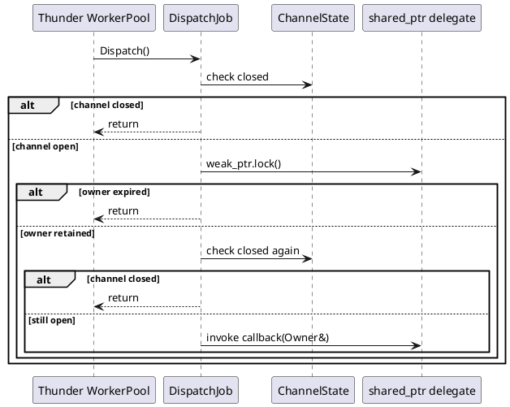
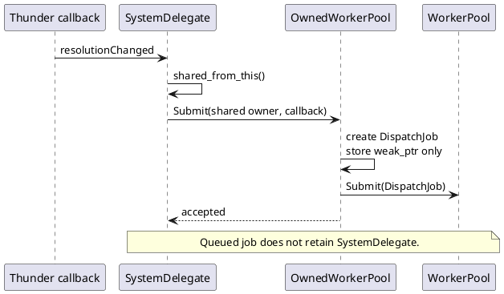
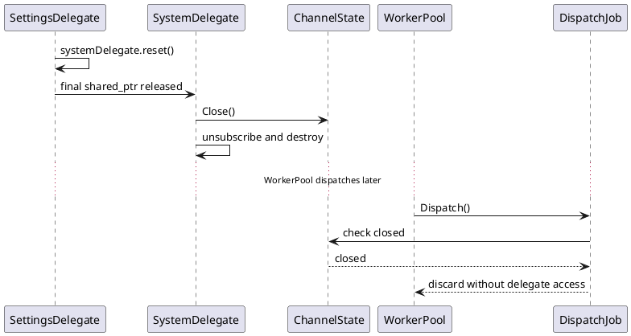
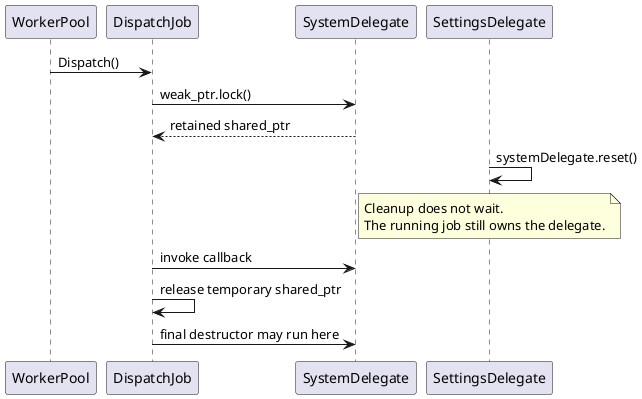
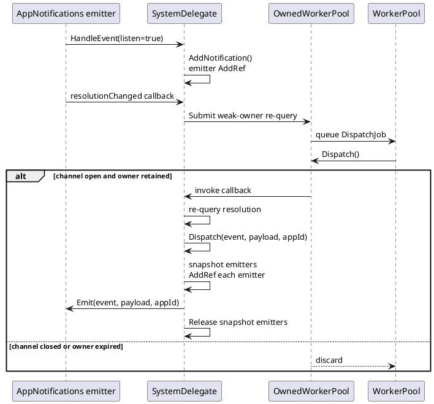

# Asynchronous Job Lifecycle

> **Repository:** `entservices-appgateway`
>
> **Scope:** WorkerPool jobs that access plugin, delegate, event-emitter, or other owner state.
>
> **Thunder changes:** None.

## 1. Job helper overview

### 1.1 `OwnedWorkerPool<Owner>`

Use for delegates managed by `std::shared_ptr`. A queued envelope stores `std::weak_ptr<Owner>`, so pending work does not keep the delegate alive. At dispatch, the helper locks the weak pointer and invokes the callback only when the channel is open and the owner still exists. `Close()` is nonblocking; queued work dispatched afterward is discarded. Examples include SystemDelegate, VideoOutputDelegate, NetworkDelegate, and BaseEventDelegate notification fan-out.

### 1.2 `IntrusiveJobChannel<Owner>`

Use for plugin or COM objects that implement `AddRef()`/`Release()` and already have a logical shutdown hook. Queued work stores channel state rather than an owner reference. Dispatch upgrades the owner under the channel mutex by calling `AddRef()`; an RAII guard calls `Release()` after the callback. `Close()` detaches the owner before final release, allowing stale queued jobs to discard without blocking shutdown. LaunchDelegate uses this policy.

### 1.3 `RetainedJobQueue<Owner>`

Use for intrusive implementation objects that have `AddRef()`/`Release()` but no existing shutdown method that can close a weak channel safely. The queue acquires `AddRef()` at submission and releases it when the envelope is destroyed. This prevents use-after-free and does not make deinitialization wait, but queued work can defer final object destruction and is not canceled as broken-pipe work. AppGateway implementation, AppNotifications, AppActions, and comparable remote implementation jobs use this policy.

| Helper | Owner model | Queued job retains owner? | Work after shutdown |
|---|---|---:|---|
| `OwnedWorkerPool` | `shared_ptr` delegate | No | Discard when closed/expired |
| `IntrusiveJobChannel` | AddRef/Release with close hook | No | Discard when closed/detached |
| `RetainedJobQueue` | AddRef/Release without close hook | Yes | May finish safely; destruction can be deferred |

All callbacks receive `Owner&`; request and event data must be copied into the envelope rather than capturing raw `this`.

## 2. Foundation

### 2.1 Thunder WorkerPool and `Core::IDispatch`

Thunder's global `Core::IWorkerPool` queues a `Core::ProxyType<Core::IDispatch>` and invokes `Dispatch()` later on a worker thread.

WorkerPool retains the `Core::IDispatch` job object. It does not automatically retain the plugin or delegate used by that job.

| Lifetime | Managed by |
|---|---|
| Job object implementing `Core::IDispatch` | Thunder WorkerPool and `Core::ProxyType` |
| Delegate/plugin accessed by `Dispatch()` | Repository ownership policy |

### 2.2 Job owner

The **job owner** is the object whose methods or state are used asynchronously. Examples include:

- `SystemDelegate`
- `VideoOutputDelegate`
- `NetworkDelegate`
- `AppGatewayCommon`
- `AppGatewayResponderImplementation`

### 2.3 Job envelope

“Job envelope” is a design term for the actual `Core::IDispatch` object submitted to WorkerPool. It is not a class named `ResolveEnvelope` or `ExampleOwner`.

For shared-owner jobs, the actual envelope is the private nested class:

```cpp
OwnedWorkerPool<Owner>::DispatchJob
```

It stores:

- shared channel state;
- a `weak_ptr<Owner>`;
- copied request/event data inside the callback;
- a typed callback receiving `Owner&`.

It does not store a raw owner pointer.

### 2.4 Shared ownership

AppGatewayCommon domain delegates are created by `SettingsDelegate` with `make_shared`:

```cpp
systemDelegate = std::make_shared<SystemDelegate>(shell);
videoOutputDelegate = std::make_shared<VideoOutputDelegate>(shell);
```

The correct dispatch-time lifetime operation is therefore:

```cpp
std::shared_ptr<Owner> owner = weakOwner.lock();
```

This is equivalent to Rust `Weak::upgrade()`.

A queued job stores only the weak pointer. It does not prevent delegate destruction.

## 3. Previous usage

### 3.1 Lambda capturing raw `this`

System and VideoOutput notification callbacks previously submitted zero-argument lambdas:

```cpp
PostToWorkerPool([this]() {
    EmitOnScreenResolutionChanged();
    EmitOnVideoResolutionChanged();
});
```

The lambda retained only the pointer value. If SettingsDelegate destroyed the delegate before WorkerPool ran the lambda, `this` referred to a destroyed object.

### 3.2 Job-specific raw parent

Other plugin jobs use a job-specific parent pointer:

```cpp
Core::IWorkerPool::Instance().Submit(
    RespondJob::Create(
        this,
        context.connectionId,
        context.requestId,
        payload));
```

Such jobs require a separate ownership protocol. Merely deriving the job from `Core::IDispatch` protects the job object, not `this`.

### 3.3 Blocking drain

Several paths added counters and condition variables:

```cpp
mJobDrainCv.wait(lock, [this] {
    return mActiveJobs.load() == 0;
});
```

This prevents owner destruction while jobs remain active, but shutdown now depends on WorkerPool progress and downstream service latency.

### 3.4 Problems with the previous patterns

- Raw `this` could be stale at dispatch.
- Job-specific parent handling was duplicated.
- Queued jobs could retain owners longer than needed.
- Deinitialization could block indefinitely.
- New jobs did not require an explicit ownership choice.

## 4. New helper: `OwnedWorkerPool<Owner>`

The helper is defined in `helpers/OwnedWorkerPool.h`.

### 4.1 Internal parts

| Part | Responsibility |
|---|---|
| `ChannelState` | Heap-owned state containing an atomic closed flag |
| `DispatchJob` | Actual `Core::IDispatch` envelope |
| `weak_ptr<Owner>` | Non-owning owner capability stored while queued |
| `Create()` | Creates an envelope without submitting it; primarily for tests |
| `Submit()` | Creates and submits an envelope to WorkerPool |
| `Close()` | Closes the channel without waiting |
| `Closed()` | Reports whether the channel is closed |

### 4.2 Submission

```cpp
template <typename Work>
bool Submit(const std::shared_ptr<Owner>& owner, Work work);
```

`Submit()` rejects when:

- `owner` is null; or
- the channel is already closed.

Otherwise it creates a `DispatchJob` holding `weak_ptr<Owner>` and submits the envelope to WorkerPool.

### 4.3 Dispatch

`DispatchJob::Dispatch()` performs:

1. Check the channel closed flag.
2. Call `weak_ptr::lock()`.
3. Return if the owner expired.
4. Check the closed flag again.
5. Invoke the callback with retained `Owner&`.



The temporary shared pointer protects the owner until callback return. No condition-variable wait is needed.

## 5. SettingsDelegate cleanup and delayed dispatch

This is the main lifecycle scenario.

Assume `SystemDelegate` queues a resolution job, but WorkerPool does not dispatch it until after `SettingsDelegate::Cleanup()` resets the delegate.

### 5.1 State at submission

- `SystemDelegate` is owned by `shared_ptr`.
- `PostToWorkerPool()` obtains a shared pointer from `shared_from_this()`.
- `OwnedWorkerPool::Submit()` converts it to `weak_ptr<SystemDelegate>` inside the envelope.
- The local shared pointer is released when submission returns.
- WorkerPool owns the envelope, but the envelope does not keep SystemDelegate alive.



### 5.2 SettingsDelegate releases the delegate

```cpp
void SettingsDelegate::Cleanup()
{
    systemDelegate.reset();
    videoOutputDelegate.reset();
    // reset remaining delegates
}
```

If no callback is already running, resetting the final shared pointer starts the delegate destructor. The destructor closes the job channel before releasing subscription resources:

```cpp
SystemDelegate::~SystemDelegate()
{
    mWorkerPool.Close();
    // unsubscribe and release resources
}
```

### 5.3 WorkerPool dispatches later

The envelope still has a safe `shared_ptr<ChannelState>`, but its weak owner has expired.

Dispatch:

1. Checks the closed state.
2. Calls `weak_ptr::lock()` if needed.
3. Gets an empty shared pointer.
4. Returns without calling SystemDelegate.
5. Does not query DisplaySettings.
6. Does not dispatch an app event.
7. Is eventually destroyed by WorkerPool.



This is the broken-pipe behavior: queued work arrives after shutdown and is consumed without business processing.

### 5.4 Callback started before cleanup

If dispatch successfully locks the weak pointer before cleanup:

- the callback owns a temporary `shared_ptr<SystemDelegate>`;
- `SettingsDelegate::Cleanup()` resets its own pointer and returns;
- final delegate destruction is deferred until the callback releases its temporary shared pointer;
- the destructor and resource cleanup do not run concurrently with that callback.



Unlike intrusive ownership, shared ownership naturally defers the destructor and its resources while a callback runs.

## 6. Actual SystemDelegate usage

### 6.1 Channel member

```cpp
OwnedWorkerPool<SystemDelegate> mWorkerPool;
```

### 6.2 Submission helper

```cpp
bool PostToWorkerPool(std::function<void(SystemDelegate&)> work)
{
    std::shared_ptr<SystemDelegate> owner(
        std::dynamic_pointer_cast<SystemDelegate>(
            shared_from_this()));

    return mWorkerPool.Submit(owner, std::move(work));
}
```

### 6.3 Resolution callback

```cpp
void OnDisplaySettingsResolutionChanged(const VariantContainer&)
{
    PostToWorkerPool([](SystemDelegate& owner) {
        const bool screenEmitted =
            owner.EmitOnScreenResolutionChanged();
        const bool videoEmitted =
            owner.EmitOnVideoResolutionChanged();
    });
}
```

The lambda captures no owner. It receives a valid owner only after dispatch-time upgrade.

### 6.4 Shutdown

```cpp
SystemDelegate::~SystemDelegate()
{
    mWorkerPool.Close();
    // unsubscribe from DisplaySettings and SystemServices
    // release interfaces and links
}
```

The same pattern is used by `VideoOutputDelegate` for resolution, HDCP, CEC, and port-change jobs.

## 7. AppGateway response job

`AppGatewayResponderImplementation::Respond()` is not yet migrated. The current path submits `RespondJob::Create(this, ...)` directly.

The migration must introduce an ownership policy appropriate for `AppGatewayResponderImplementation`, then copy:

- `connectionId`;
- `requestId`;
- `payload`;
- any app ID needed for telemetry or hibernation checks.

The callback must receive a retained `AppGatewayResponderImplementation&`; it must not capture `this`.

Target behavior:

| State | Result |
|---|---|
| Application paused | Preserve existing hibernation drop behavior |
| Channel open and owner retained | Call `ReturnMessageInSocket()` |
| Submission after close | Reject |
| Queued dispatch after close | Discard without socket access |
| Callback already running | Retained ownership permits completion; close does not wait |

This section describes the required migration contract. It does not claim that responder migration is already implemented.

## 8. Event subscription and notification

### 8.1 Registration ownership

`BaseEventDelegate` stores emitter registrations under `mRegisterMutex`.

```cpp
if (listen) {
    AddNotification(event, emitter);
} else {
    RemoveNotification(event, emitter);
}
```

Reference rules:

- `AddNotification()` takes the map-owned emitter reference.
- `RemoveNotification()` releases the map-owned reference.
- Dispatch snapshots emitters under the mutex.
- Every snapshot takes a temporary AddRef.
- Every emit attempt releases its snapshot reference.

### 8.2 Resolution event flow



### 8.3 Remaining EventDelegate migration

The producer job is weak-owner safe, but `BaseEventDelegate::EventDelegateDispatchJob` currently stores a strong `shared_ptr<BaseEventDelegate>`.

The final migration must ensure:

- event registration is rejected after event-channel closure;
- event name, payload, and app ID are copied;
- queued notification holds only weak delegate ownership;
- closed or expired dispatch does not call `Emit()`;
- running notification retains the delegate and emitter snapshot until completion.

## 9. Objects with a different ownership model

`OwnedWorkerPool` is for `shared_ptr` owners. Do not use it for every object automatically.

| Target object | Required policy |
|---|---|
| Delegate managed by `shared_ptr` | `OwnedWorkerPool` |
| Plugin/COM object with AddRef/Release | Intrusive dispatch-time upgrade |
| Object embedded inside a retained plugin | Submit through the outer plugin owner |
| Raw or stack object without retained outer owner | Do not reference asynchronously |
| Value-only work | Approved detached job |

## 10. Job timing telemetry

Migration must preserve existing timing instrumentation.

`AGW_TIME_JOB` requires a `JobTiming` object because it reads `this->JobSubmitTime()`. Timed framework envelopes must therefore inherit `JobTiming` and own the timing macro.

System/VideoOutput re-query jobs did not previously carry `AGW_TIME_JOB`; do not invent a new timing identity without a deliberate telemetry decision.

## 11. Self-retaining policy and reviewed exceptions

`RetainedJobQueue<Owner>` is used for intrusive implementation objects that have `AddRef()`/`Release()` but no existing logical shutdown interface. It centralizes submission-time retention and RAII release without introducing an interface change.

Reviewed direct-submission exceptions are limited to:

- `PluginHost::IShell::Job`, owned by Thunder for plugin deactivation;
- `UtilsController::activatePlugin`, which synchronously waits on its local event before referenced stack values leave scope;
- direct WorkerPool calls inside the approved job helpers.

## 12. Enforcement

Repository checks must reject:

- direct owner-dependent WorkerPool submissions outside approved helpers or reviewed allowlist;
- asynchronous `[this]`, implicit `[=]`, or mixed raw-owner captures unless a reviewed self-retaining implementation job balances AddRef/Release;
- unprotected raw parent members in dispatch jobs;
- owners without a close-before-release lifecycle path.

Detached jobs require a narrow reviewed allowlist and copied data only.

## 13. Tests required for a new job or event

- normal dispatch;
- submission after close;
- queued dispatch after close;
- expired owner;
- close-before-upgrade;
- upgrade-before-close;
- running-owner retention;
- old generation remains canceled;
- no stale event, response, or emitter callback;
- balanced references;
- telemetry identity where applicable.

Use barriers or controlled dispatch rather than fixed sleeps for race tests.

## 14. Review checklist

- What object does the job access?
- Is it shared, intrusive, embedded, or value-only?
- Does the selected helper match that ownership model?
- Does the queued envelope avoid retaining the owner?
- Are inputs copied by value?
- Is the channel closed before resource release?
- Are emitter references balanced?
- Is timing telemetry preserved where applicable?
- Are raw owner captures absent?
- Are both close/dispatch race outcomes tested?
