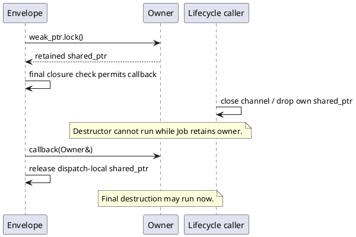

# Asynchronous Job Lifecycle

> **Repository:** entservices-appgateway
>
> **Scope:** Owner-dependent Thunder WorkerPool jobs, delegate cleanup, event emitters, and shutdown boundaries.
>
> **Compatibility:** Repository-owned C++11-compatible helpers; no Thunder changes.

## 1. Ownership policies implemented here

WorkerPool retains a `Core::ProxyType<Core::IDispatch>` envelope. It does not automatically retain the plugin or delegate used by that envelope.

| Helper | Queued owner retention | Dispatch and release | Shutdown behavior |
|---|---|---|---|
| SharedOwnerChannel | Weak owner handle; shared channel state | Upgrade weak pointer; release dispatch-local shared ownership on exit | Discard if closed or expired; no drain |
| RetainedJobQueue | AddRef during envelope construction | Invoke with retained owner; Release at envelope destruction | No helper-level close/cancellation; final destruction may be deferred |

Sources: [SharedOwnerChannel](../helpers/SharedOwnerChannel.h), [RetainedJobQueue](../helpers/RetainedJobQueue.h).

`IntrusiveOwnerChannel` is implemented only in app-gateway-cpc. It is not an available API in this repository. Its cross-repository contract requires channel closure while a known strong owner reference still exists, before final external Release; first closure in a destructor is insufficient.

All helpers pass `Owner&` to callbacks. Copy request/event inputs and use that supplied reference instead of capturing raw `this`. The callable signature does not itself reject unsafe captures.

## 2. SharedOwnerChannel behavior

### Submission

The helper accepts a valid `const std::shared_ptr<Owner>&` and a by-value callable. `Create()` creates without submitting; `Submit()` submits to WorkerPool. `CreateTimed()` and `SubmitTimed()` add timing metadata. Creation rejects null owner or observed closure.

Envelopes contain a shared channel-state handle, weak owner handle, and `std::function<void(Owner&)>`. Pending work does not retain the owner through that handle. Capturing an extra strong owner reference in the callable can defeat this property.

### Dispatch and closure

Dispatch:

1. Checks closure.
2. Locks weak ownership; discards if expired.
3. Checks closure again.
4. Invokes the callback with dispatch-local shared ownership.

Close stores the atomic flag and does not wait for queued/running work. A submission racing with Close may still queue an envelope that later discards. A callback admitted by the final closure check may begin or continue after Close returns.

The temporary shared pointer prevents final destruction during the callback. It does not serialize explicit Cleanup of members, stop producers, or guarantee socket/service availability.

The channel has no Open operation. A reusable activation needs a new channel or another explicit generation policy. `shared_from_this()` is a way of obtaining an existing shared owner, not a replacement for already-established lifetime.



## 3. SettingsDelegate and domain delegate cleanup

[SettingsDelegate](../AppGatewayCommon/delegate/SettingsDelegate.h) creates domain delegates with shared ownership. Its child-pointer initialization, getters, and registration snapshots use `mChildrenMutex`.

`HandleAppEventNotifier()` takes strong snapshots under that mutex and invokes child handlers outside it. Cleanup swaps the child pointers into detached local storage under the same mutex, then destroys the detached storage outside the lock. Existing snapshots retain their children safely.

[AppGatewayCommon::Deinitialize](../AppGatewayCommon/AppGatewayCommon.cpp) sets shutdown and detaches its SettingsDelegate under `mDelegateMutex`, then performs cleanup outside the outer mutex. This avoids destroying children while holding that outer lock.

Cleanup explicitly closes all seven children's event channels and System/Network/VideoOutput worker channels before releasing the detached storage. Close does not drain or wait for admitted callbacks, and it does not reset their resources. A retained child therefore survives safely while queued channel work that observes closure is discarded.

Each child independently owns a balanced shell reference through final destruction. Event-producing children retain it in BaseEventDelegate; AppDelegate retains it directly. A callback that resumes a lazy interface lookup after AppGatewayCommon releases its own mShell still has a live shell. Closure rejects late notification registrations under the same mutex that guards the registration map.

### Actual destructor ordering

| Delegate | Current worker-channel/resource order |
|---|---|
| SystemDelegate | Unsubscribe/unregister producers, reset links/resources, then `_workerPool.Close()` |
| VideoOutputDelegate | Unsubscribe producers, reset links/resources, then `_workerPool.Close()` |
| NetworkDelegate | `mWorkerPool.Close()`, unregister notification handler, release network manager |
| BaseEventDelegate | Close event channel, release map-owned emitter references |

System/VideoOutput `PostToWorkerPool()` obtain derived shared ownership, catch `std::bad_weak_ptr`, and submit callbacks receiving the typed delegate. A successful dispatch upgrade defers final destruction; the catch alone does not prove raw producer entry is safe.

Do not describe these destructors as implementing a uniform close-unregister-drain-release protocol. There is no helper job drain. Unsubscribe calls can have their own waits/timeouts.

## 4. AppGatewayCommon registration: retained, not generation-canceled

`SubmitEventRegistration()`:

1. Checks shutdown and the delegate under `mDelegateMutex`.
2. AddRefs the emitter and wraps it with a releasing shared pointer.
3. Submits through `RetainedJobQueue<AppGatewayCommon>`.
4. At execution, calls `GetDelegateSafe()` and dispatches only if a current delegate is available.

This retains the plugin while queued; it does not use a weak-owner registration channel. Shutdown checks prevent queued work from using a detached delegate while shutdown remains active.

**Unresolved activation gap:** Initialize installs a new delegate and clears the shared shutdown flag. An old queued registration captures no generation and looks up the current delegate at dispatch. After same-instance Deinitialize/Initialize, that old job can reach the new activation. Do not claim old-generation cancellation for this path. A targeted regression test and an activation-policy fix remain follow-up work.

## 5. Retained implementation jobs and responder

RetainedJobQueue is used by AppGateway implementation/responder, AppActions, AppNotifications, and AppGatewayCommon registration. It centralizes submission-time AddRef and envelope-destruction Release.

The caller must already guarantee owner lifetime before acquisition. Owner retention does not protect explicitly released resources, solve raw producer ingress, or distinguish activations. The helper does not drain the queue or promise every accepted job will execute; disposing an envelope without dispatch still releases its owner reference.

### AppNotifications subscription teardown

Public subscription and Emit envelopes retain the implementation as before. Its final destructor closes shared subscriber-state delivery, explicitly cleans the subscription manager while shell and emitter are alive, then releases its emitter reference and clears the shell alias. Later manager destruction is harmless because cleanup has emptied its registration list.

The incoming emitter is independently reference-counted with Core::Service<Emitter>. It owns shared SubscriberMap state, including a balanced shell reference and cached responder interfaces, without retaining or borrowing the implementation. Incoming NotifEmitJob envelopes retain this emitter. A provider or asynchronously accepted unregister may keep that emitter alive after implementation destruction; deliveries observing closed state are discarded, and admitted state callbacks may finish safely. This does not claim synchronous unsubscribe completion or general producer quiescence.

### Event-hook result handling

EventHookJob checks FetchResolvedData. ERROR_NONE and the existing uint32_t(-1) asynchronous-pending sentinel preserve fire-and-forget behavior. Other results are logged with the hook identity and error code; they do not replace the primary subscription response or trigger an unsolicited response.

### Responder behavior

[AppGatewayResponderImplementation::Respond](../AppGateway/AppGatewayResponderImplementation.cpp) uses `RetainedJobQueue<AppGatewayResponderImplementation>`:

```cpp
RetainedJobQueue<AppGatewayResponderImplementation>::SubmitTimed(
    this, "RespondJob", requestId, connectionId, context.appId,
    [connectionId, requestId, payload](AppGatewayResponderImplementation& owner) {
        owner.DispatchResponseToConnectionIfNotPaused(connectionId, requestId, payload);
    });
```

| State | Behavior |
|---|---|
| App paused at submission | Drop response and return ERROR_NONE without queuing |
| Envelope dispatches | Invoke dispatch-time hibernation check |
| Connection's registered app is paused | Drop without socket response |
| Dispatch-time check permits | Attempt ReturnMessageInSocket |
| Logical shutdown | No helper-level close/reject/discard gate; pending jobs retain owner |

The old responder RespondJob class was removed; the string `RespondJob` remains a telemetry identity. Retention does not guarantee socket availability or delivery.

The local retained helper forwards `Work&&` using `std::forward`; CPC's copy still takes callable parameters by value. Both store `std::function<void(Owner&)>`, not a general move-only callable wrapper.

## 6. Event dispatch and emitter ownership

[BaseEventDelegate](../helpers/BaseEventDelegate.h) production Dispatch uses SharedOwnerChannel and copies event name, payload, and app ID. The public nested `EventDelegateDispatchJob` remains and strongly retains its delegate; AppGateway L1 legacy-job tests still instantiate it. It is not the normal production submission path.

The non-virtual CloseNotificationChannel closes event admission during logical cleanup and again as a destructor fallback. It synchronizes with AddNotification and emitter snapshots under mRegisterMutex. Closed delegates reject late registrations and return empty delivery snapshots, including for legacy queued jobs. Map-owned emitter references remain intact until removal or final destruction so already-admitted callbacks retain their dependencies.

Reference rules:

- A newly registered emitter gets one map-owned AddRef; duplicates do not add another map reference.
- RemoveNotification releases map-owned references.
- GetEmittersForNotification snapshots and AddRefs emitters under `mRegisterMutex`.
- The normal Emit loop runs outside the map lock and releases snapshot references afterward.
- Destructor cleanup releases remaining map-owned references.

The current loop has no per-emitter RAII release guard around Emit; normal-return balancing is not a general exception-safety guarantee for throwing emitters.

## 7. Timing telemetry

Timed envelopes inherit `AppGatewayTelemetryHelper::JobTiming` and invoke `AGW_TIME_JOB` in Dispatch because the macro reads the envelope's submit time. Shared timed envelopes construct the timing scope before checking closure, so canceled business work may still have timing activity.

Preserve job names and request/connection/app identifiers. System/VideoOutput re-query submissions use the untimed shared Submit path; do not invent timing identities during migration without an explicit telemetry decision.

## 8. Actual enforcement and reviewed boundaries

[EnforceAsyncJobOwnership.cmake](../cmake/EnforceAsyncJobOwnership.cmake) uses regex guardrails. [AppGatewayCommon/CMakeLists.txt](../AppGatewayCommon/CMakeLists.txt) supplies an explicit source list, not a recursive all-production scan.

The checks detect:

- direct `IWorkerPool::Instance().Submit` syntax, except the matched Thunder shell-job form;
- a limited pointer member pattern named mParent/mOwner in a Job class;
- raw-this/equals capture syntax passed specifically to PostToWorkerPool.

They do not prove the absence of arbitrary unsafe captures through other APIs, raw owner references, aliases, or lifecycle-ordering violations. Existing fixtures test the patterns present in the script, not every negative case listed in planning tasks. Shared Submit deletes raw owner overloads, but `std::function` compatibility does not inspect captures.

Reviewed boundaries include Thunder-owned shell deactivation jobs, synchronously waited activation work in UtilsController, and helper internals. The allowlist descriptions are not general executable permission rules for arbitrary new patterns.

## 9. Design status and unresolved gaps

- The single current [OpenSpec change](../openspec/changes/nonblocking-job-cancellation/proposal.md) consolidates specification, design, and tasks. Its spec distinguishes channel cancellation from retained-envelope ownership; activation isolation and comprehensive enforcement remain unmet target requirements.
- IntrusiveOwnerChannel is documented as a cross-repository policy only; it is not implemented here.
- The superseded `drain-lambda-worker-jobs` plan has been moved outside OpenSpec into workspace documentation history. Only `nonblocking-job-cancellation` remains active; historical drain tasks and requirements are not the current contract.
- AppGatewayCommon activation isolation and broader ownership enforcement remain unresolved as described above.
- Weak/retained ownership does not independently prove producer quiescence, resource synchronization, or absence of cycles.
- Some source-header comments still use blocking/destructor-only terminology. The method bodies implement the contracts documented here; comments are not extra lifecycle guarantees.

## 10. Verification and review checklist

For channel work, verify normal dispatch, null/expired owner, observed-closed rejection, queued discard, both admission/closure outcomes, and admitted-owner retention. For retained work, verify null rejection, envelope-lifetime retention, balanced references, exception/early-return followed by envelope disposal, and destruction without dispatch. Test generation isolation only where the integration supplies it; do not infer it from reference counting.

Also verify emitter balance, business payloads, producer and resource lifetime, and timing identities. Prefer barriers or controlled dispatch over fixed sleeps. Tests of the legacy strong job are not evidence of weak production-envelope behavior.

For code changes, run the plugin build and applicable L0/L1 executions using the workspace Docker workflow. L1 must actually configure, compile, and execute; an unsupported/no-op build-script l1 invocation is not evidence. Record revision, exact commands, counts, and blockers separately. Current review-fix verification is recorded in section 8 of the change's tasks.md; earlier checked verification records remain historical.
